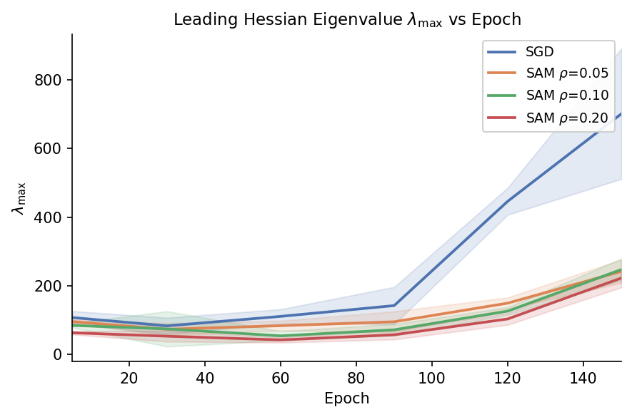
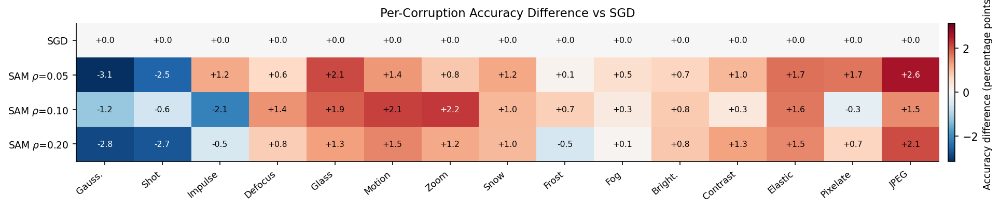
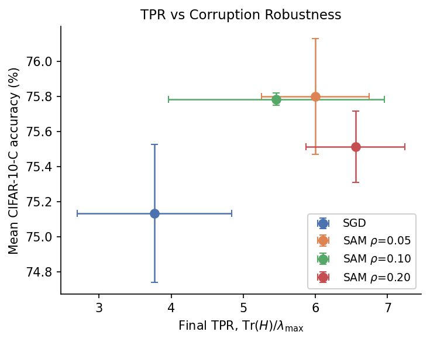

# Beyond Flatness: A Spectral Analysis of SAM's Loss Landscape Geometry for OOD Generalization

*[Code and results for the paper](https://openreview.net/forum?id=EBnr0nVRJd)*

*Group project for COMP4329 (Deep Learning) at the University of Sydney.*

**Paper:** [Beyond Flatness: A Spectral Analysis of SAM's Loss Landscape Geometry for OOD Generalization](https://openreview.net/forum?id=EBnr0nVRJd)

**Research question.** Is the out-of-distribution (OOD) robustness of Sharpness-Aware Minimization (SAM) explained by the spectral geometry of the minima it finds, and not only by their flatness?

**Hypothesis.** SAM converges to solutions whose Hessian is less spectrally concentrated than with SGD: curvature is spread across many directions instead of being dominated by a single top eigenvalue.

We train ResNet-18 on CIFAR-10 with SGD and with SAM at three perturbation radii, evaluate every model on all of CIFAR-10-C, and track the Hessian of the loss at six points during training.

## Method

| | |
|---|---|
| Model | ResNet-18 with a CIFAR stem (3x3 conv, stride 1, no max-pool) |
| Optimizers | SGD baseline; SAM with ρ ∈ {0.05, 0.10, 0.20} wrapping the same SGD |
| Training | 150 epochs, batch 128, lr 0.1, momentum 0.9, weight decay 5e-4, cosine annealing, random crop + horizontal flip |
| Seeds | 3 per configuration (69, 420, 1312), 12 training runs in total |
| OOD evaluation | CIFAR-10-C, all 15 corruptions x 5 severities (750k images per model) |
| Hessian analysis | Checkpoints at epochs 5, 30, 60, 90, 120, 150. Using [PyHessian](https://github.com/amirgholami/PyHessian): top eigenvalue λ_max by power iteration and trace Tr(H) by Hutchinson's estimator, on a fixed batch of 128 CIFAR-10 test images |
| Spectral concentration | Trace-to-peak ratio, TPR(H) = Tr(H) / λ_max (see below) |

**Trace-to-peak ratio.** The trace is the sum of all Hessian eigenvalues, so TPR(H) = Tr(H) / λ_max compares the total curvature with the curvature along the sharpest direction. If one eigenvalue carries all the curvature, TPR = 1; if the curvature is split evenly over k directions and is zero elsewhere, TPR = k. A **high TPR** therefore means the curvature is spread across many directions; a **low TPR** means it is dominated by the top eigenvalue. TPR measures the *shape* of the spectrum, independently of its scale: a minimum can be flat (small λ_max) and still have a concentrated spectrum, or the other way round.

The SAM optimizer is adapted from [davda54/sam](https://github.com/davda54/sam). The papers, code and datasets the project builds on are listed in [REFERENCES.md](REFERENCES.md).

## Data

- **CIFAR-10**: downloaded automatically by `torchvision`.
- **CIFAR-10-C** (Hendrycks & Dietterich, 2019): download from [Zenodo](https://zenodo.org/record/2535967) and pass the folder containing `<corruption>.npy` and `labels.npy` with `--cifar10c-root`.

## Results

All numbers are mean ± standard deviation over the 3 seeds, taken from the CSVs in `results/`. Hessian values are at epoch 150.

| Config | CIFAR-10 test acc. (%) | Mean CIFAR-10-C acc. (%) | λ_max | Tr(H) | TPR |
|---|---|---|---|---|---|
| SGD | 95.28 ± 0.19 | 75.13 ± 0.39 | 700.1 ± 189.4 | 2572 ± 656 | 3.77 ± 1.07 |
| SAM ρ=0.05 | 95.92 ± 0.12 | **75.80 ± 0.33** | 242.0 ± 33.8 | 1436 ± 22 | 6.00 ± 0.75 |
| SAM ρ=0.10 | 95.98 ± 0.09 | 75.78 ± 0.03 | 247.3 ± 31.6 | 1322 ± 211 | 5.46 ± 1.50 |
| SAM ρ=0.20 | **96.04 ± 0.15** | 75.51 ± 0.20 | 222.5 ± 27.1 | 1462 ± 258 | 6.56 ± 0.68 |

Sources: `results/training_agg.csv`, `results/cifar10c_summary.csv`, `results/hessian_final_summary.csv`.

**1. SAM improves both in-distribution and OOD accuracy, by a small margin.** All SAM runs beat SGD on clean CIFAR-10 (+0.6 to +0.8 points) and on mean CIFAR-10-C accuracy (+0.4 to +0.7 points). On CIFAR-10-C the best radius is ρ=0.05, not the largest one.

**2. SAM strongly suppresses the top eigenvalue.** At epoch 150, λ_max is about 3x lower and the trace 1.8 to 1.9x lower than with SGD, and every SAM run ends with a lower λ_max (206 to 280) than every SGD run (545 to 911). The curves are close until epoch 90; the gap opens in the last third of training, when the learning rate is small and SGD's λ_max grows quickly.



**3. The robustness gain is not uniform across corruptions.** Averaged over severities, SAM helps most on JPEG compression, elastic transform, motion blur and glass blur (up to +2.6 points), and is worse than SGD on Gaussian and shot noise (down to -3.1 points). See `results/cifar10c_by_corruption.csv` and the heatmap below.



**4. SAM reaches a higher TPR than SGD, which partly supports the hypothesis.** All three SAM configurations end with a higher mean TPR (5.46 to 6.56) than SGD (3.77), and the effect holds seed by seed: in each of the three seeds, every SAM run has a higher final TPR than the SGD run with the same seed (`results/seed*/hessian_results.csv`). SAM does not just lower the curvature; it also changes the shape of the spectrum, so that the sharpest direction carries a smaller share of the total. The difference appears late in training: up to epoch 90 there is no consistent gap (SGD's TPR lies within or above the range of the SAM configurations), and SAM pulls ahead only at epochs 120 and 150 (`results/hessian_agg.csv`).

**5. TPR does not predict OOD robustness among the SAM variants, so the hypothesis does not hold in its strongest form.** Among SAM runs, ρ=0.20 has the highest mean TPR (6.56) but the lowest mean CIFAR-10-C accuracy (75.51%), while ρ=0.10 has the lowest TPR (5.46) and practically the same accuracy as the best radius (75.78% vs 75.80%). The per-seed results show the same picture: across the nine individual SAM runs, a higher final TPR does not go with higher CIFAR-10-C accuracy (`results/seed*/hessian_results.csv`, `results/seed*/cifar10c_all.csv`). The figure below shows the configuration means. The results are therefore mixed: spectral geometry separates SAM from SGD, but a single scalar such as TPR is not enough to explain OOD robustness, and richer descriptors of the Hessian spectrum would be needed.



The remaining figures (training curves, robustness bar chart, trace and TPR over training, λ_max and TPR vs ρ) are in `results/figures/`. The full discussion is in the [paper](https://openreview.net/forum?id=EBnr0nVRJd).

## Limitations

- **Hessian estimates use a single batch.** λ_max and Tr(H) are computed on one fixed batch of 128 test images with iterative estimators (100 power iterations, 30 Hutchinson samples). Seed-to-seed spread is large (for SGD, λ_max = 700 ± 189), so the Hessian numbers are noisy.
- **TPR is a single scalar.** It only uses λ_max and the trace, and the trace also includes any negative eigenvalues, so the "number of directions" reading is approximate. We did not compute the top-k spectrum or the full eigenvalue density.
- **Small sample.** Three seeds per configuration and four configurations. The differences in mean CIFAR-10-C accuracy between SAM radii (≤ 0.3 points) are within one standard deviation.
- **Correlation only.** The study compares trained models; it does not intervene on the Hessian spectrum, so it cannot establish what causes the robustness gain.
- **One architecture and one dataset.** ResNet-18 on CIFAR-10 only.
- **Accuracy, not mCE.** CIFAR-10-C results are reported as plain accuracy, not the AlexNet-normalised mean corruption error.
- **Checkpoints are not included** in the repository, so the Hessian analysis can only be rerun after retraining.

## Repository structure

```
train_all.py             Trains the 4 configurations for one seed, saves checkpoints,
                         training history and CIFAR-10-C accuracy
analyze_checkpoints.py   Computes λ_max and Tr(H) on every saved checkpoint
aggregate_results.py     Aggregates per-seed CSVs into mean ± std tables
plot_results.py          Figures A-C: training curves, CIFAR-10-C bar chart, per-corruption heatmap
plot_hessian.py          Figures D-F: λ_max and trace over training, λ_max vs ρ
plot_tpr.py              Figures G-I: TPR over training, TPR vs ρ, TPR vs CIFAR-10-C accuracy
src/
  models.py              ResNet-18 with CIFAR stem
  sam.py                 SAM optimizer
  data.py                CIFAR-10 and CIFAR-10-C loaders
  train.py               Training and evaluation loops
  hessian.py             λ_max, trace and TPR via PyHessian
results/
  seed69/, seed420/, seed1312/   Raw per-seed outputs (history, CIFAR-10-C, Hessian)
  *_agg.csv, *_summary.csv       Aggregated tables
  figures/                       Generated figures
REFERENCES.md            Papers, code and datasets used
requirements.txt         Python dependencies
```

## How to reproduce

```bash
pip install -r requirements.txt

# 1. Train the 4 configurations and evaluate on CIFAR-10-C (repeat for seeds 69, 420, 1312)
python train_all.py --seed 69 --cifar10c-root /path/to/CIFAR-10-C

# 2. Hessian analysis of the saved checkpoints
python analyze_checkpoints.py --seed 69

# 3. Copy each run's output folder to results/seed<N>/, then aggregate and plot
python aggregate_results.py --results-dir ./results
python plot_results.py
python plot_hessian.py
python plot_tpr.py
```

`train_all.py` and `analyze_checkpoints.py` write to `/kaggle/working/checkpoints/<run>` and `/kaggle/working/results/<run>` by default; `analyze_checkpoints.py` accepts `--checkpoint-dir` and `--output-dir` to change this. The experiments were run on Kaggle GPUs. Per seed, one SGD run took about 2.7 h and one SAM run about 4.5 h (SAM needs two forward-backward passes per step), around 49 GPU-hours for all 12 runs.

The aggregation and plotting steps only need the CSVs already in `results/`, so step 3 can be run without a GPU.
